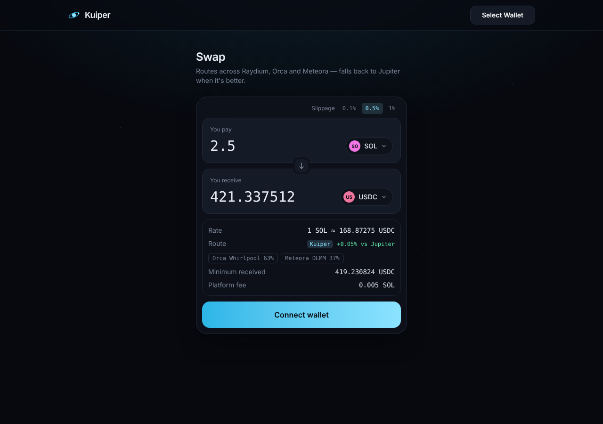

# Kuiper

A Solana DEX aggregator built the way Jupiter is built — own routing engine, own DEX adapters, own fee — with Jupiter as a fallback so it's useful from day one.



It has three parts:

1. **Swap** — every quote races **Kuiper's router** against **Jupiter's `/swap/v2/build`** on the same net amount, and the user gets whichever pays more. As adapters and the router program mature, Kuiper wins more routes and Jupiter becomes optional.
2. **Router program** (`programs/kuiper-router`) — Anchor program that executes multi-hop and split routes atomically, feeding each hop the amount the previous hop *actually* produced and enforcing one final min-out. CPI only to whitelisted DEXes.
3. **Agent** (`/agent`) — ask in plain English for a swap, stake, loan or recurring buy. Claude does the legwork (route, token safety check, simulation) and hands you a **ticket**: what it does, the numbers, balance changes from simulation, token risk flags, warnings. **Nothing moves until you approve the ticket in your own wallet** — the server never holds keys.

## How it maps to Jupiter

| Jupiter | Kuiper | Where |
|---|---|---|
| `jupiter-amm-interface` `Amm` trait | `Amm` interface (`accountsToUpdate → update → quote → swapInstructions`, no network in `quote`) | `packages/core/src/types.ts` |
| DEX SDKs integrated into Metis | Raydium CPMM (native, ported from Raydium's Rust), Orca Whirlpool, Meteora DLMM | `packages/core/src/adapters/` |
| Core engine account cache + Geyser stream | `PoolCache` — batched `getMultipleAccountsInfo` polling (gRPC in phase 3) | `packages/core/src/pool-cache.ts` |
| Metis/Iris split routing (Bellman-Ford, golden-section / Brent split ratios) | Greedy marginal split across up to 3 pools + golden-section refinement | `packages/core/src/router.ts` |
| Swap API `/order` · `/build` | `GET /quote`, `POST /swap` (simulated, CU right-sized), `POST /send` | `apps/api/src/server.ts` |
| `jupiter-amm-test-kit` quote parity | `pnpm verify:pool` — simulates the real swap from a live holder and diffs vs our quote | `apps/api/scripts/verify-pool.ts` |
| Platform / referral fee | `PLATFORM_FEE_BPS` taken from input, applied identically to both routes | `packages/core/src/tx-builder.ts` |
| jup.ag | Next.js swap UI (wallet-standard, live quotes, route breakdown) | `apps/web` |

## Repo layout

```
packages/core            router (direct, split, 2-hop), Amm interface, adapters, pool cache, tx builders  (+ vitest)
programs/kuiper-router   on-chain router (Anchor 1.2)
programs/mock-amm        test-only CP AMM used by the LiteSVM tests
programs/tests           LiteSVM integration tests against the compiled .so files
apps/api                 Hono service: quoting, tx building, DeFi agent + tickets
apps/web                 Next.js 16: swap page + agent page
```

## The agent

| Ask | What it prepares | Backed by |
|---|---|---|
| "swap 2 SOL to USDC" | Swap ticket | Kuiper router vs Jupiter, best wins |
| "stake 5 SOL" | SOL → JitoSOL / JupSOL / mSOL | Liquid staking via swap |
| "lend 500 USDC" | Earn deposit | Jupiter Lend Earn API |
| "borrow 200 USDC against 3 SOL" | New borrow position | Jupiter Lend Borrow API (experimental) |
| "buy JUP with 300 USDC weekly for 6 weeks" | Recurring order | Jupiter Recurring API |
| "is BONK safe?" | Token report | On-chain checks + Jupiter Shield |

Every ticket includes: plain-English summary, key numbers, **simulation of the exact transaction** with your balance changes, **token checks** (mint/freeze authority, Token-2022 traps like permanent delegate, transfer tax, non-transferable, holder concentration, Jupiter Shield warnings), and warnings. Tickets expire after ~60s (blockhash lifetime) and can be refreshed. Failed simulations can't be approved.

Set `ANTHROPIC_API_KEY` (and optionally `AGENT_MODEL`, default `claude-sonnet-5-5`) to enable it.

## Quick start

```bash
pnpm install
cp .env.example .env          # set RPC_URL (private RPC strongly recommended), JUP_API_KEY, FEE_WALLET
pnpm test                     # core unit tests
pnpm --filter @kuiper/api test   # agent + token-check tests
pnpm program:test             # build programs to SBF + LiteSVM tests (needs cargo-build-sbf)
pnpm discover:pools           # (re)index pools from chain → apps/api/src/pools.json
pnpm verify:pool <kind> <pool> <amount>   # adapter quote vs simulated on-chain swap
pnpm --filter @kuiper/api smoke:agent      # build + simulate every agent ticket type
pnpm dev                      # api on :8787, web on :3000
```

Jupiter's keyless tier works but rate-limits hard (frequent 429s); get a free key at <https://portal.jup.ag> for a steady fallback. On the public RPC, set `SIM_ACCOUNTS_PER_CALL=2` (default) and a slow `POOL_REFRESH_MS`; with Helius/Triton raise both.

### Before you put real money through it

1. **Verify every pool you add** against mainnet: an exact match means the adapter math is right.
   ```bash
   pnpm verify:pool orca-whirlpool Czfq3xZZDmsdGdUyrNLtRhGc47cXcZtLG4crryfu44zE 1000000000
   pnpm verify:pool meteora-dlmm 5rCf1DM8LjKTw4YqhnoLcngyZYeNnQqztScTogYHAS6 1000000000
   ```
2. **Add Raydium CPMM pools** — discover them on-chain, verify, then add to `apps/api/src/pools.json`:
   ```bash
   pnpm discover:cpmm So11111111111111111111111111111111111111112 EPjFWdd5AufqSSqeM2qN1xzybapC8G4wEGGkZwyTDt1v
   ```
3. **Create fee token accounts** for mints you want to earn on (fees on SPL inputs are skipped until the account exists, so users never pay your rent):
   ```bash
   FEE_KEYPAIR=~/.config/solana/fee.json pnpm fee-accounts EPjFWdd5AufqSSqeM2qN1xzybapC8G4wEGGkZwyTDt1v
   ```
4. Do a small swap from a burner wallet.

## Live mainnet results (Nov 11, 2026)

Run against Solana mainnet from the public RPC, with nothing signed or sent; every swap was simulated from a public exchange wallet.

**Adapters: quote = simulated on-chain output, exact to the base unit**

| Pool | Trade | Quote | On-chain |
|---|---|---|---|
| Orca Whirlpool SOL/USDC | 1 SOL → USDC | 84,809,849 | 84,809,849 ✅ |
| Orca Whirlpool SOL/USDC | 500 USDC → SOL | 5,891,080,762 | 5,891,080,762 ✅ |
| Meteora DLMM SOL/USDC | 1 SOL → USDC | 84,796,018 | 84,796,018 ✅ |
| Raydium CPMM SOL/USDC | 0.01 SOL → USDC | 842,192 | 842,192 ✅ |

**Full swap transactions built by `/swap` and simulated:** 1 SOL→USDC, 50 USDC→SOL, 50 USDC→BONK (split 82% Meteora / 18% Orca), 1 SOL→JitoSOL, 1 SOL→JUP all pass, using 36k–82k compute units.

**Agent tickets simulated on mainnet:** stake (1 SOL → 0.7635 JitoSOL), lend (100 USDC → 93.52 jlUSDC at ~4.5% APY), borrow (50 USDC against 2 SOL), recurring (300 USDC → JUP over 3 days), and token checks all pass.

**Kuiper vs Jupiter:** on the pools Kuiper indexes, Kuiper ties Jupiter on LSTs (JitoSOL ±0.000%). Jupiter wins SOL/USDC by ~0.1% through prop AMMs (GoonFi, HumidiFi, SolFi…) and some long-tail pairs (JTO −0.4%) through venues Kuiper doesn't integrate yet (Raydium CLMM, 1DEX, ZeroFi). The hybrid design handles this today by always giving the user the better of the two; closing the gap means more adapters (see roadmap).

**Pool index:** `pnpm discover:pools` indexes 14 pairs across the three DEXes from chain and keeps 35 pools with real depth (`apps/api/src/pools.json`). Raydium's CPMM pools are mostly thin for majors; Raydium's depth sits in CLMM/AMM v4.

## Deploying the router

```bash
anchor keys sync          # generates YOUR program keypair and updates declare_id! + Anchor.toml
pnpm program:build        # target/deploy/kuiper_router.so (SBPF v0, ~105 KB)
solana program deploy target/deploy/kuiper_router.so --program-id target/deploy/kuiper_router-keypair.json
```

Then set `KUIPER_ROUTER_PROGRAM_ID` in `.env` and update `KUIPER_ROUTER_PROGRAM_ID` in `packages/core/src/router-program.ts`. Deploy rent for a ~105 KB program is roughly 1.5 SOL. Get it audited before routing meaningful volume through it.

## Design notes

- **Multi-hop needs the program.** Chaining A→B→C atomically needs something on-chain that passes hop 1's *actual* output into hop 2. The router program measures each hop's output as a balance delta and patches it into the next DEX instruction before the CPI. Until it's deployed (`KUIPER_ROUTER_PROGRAM_ID` unset), Kuiper quotes direct pairs only and multi-hop goes to Jupiter.
- **Agent safety.** The agent can only call prepare/read tools. Tickets carry an unsigned transaction; the user's wallet is the only signer. The submit endpoint checks the fee payer is the ticket's wallet. Recurring/Lend transactions come from Jupiter's APIs and are simulated the same way before you see them.
- **Why `/build`, not `/order`, for the fallback.** `/build` returns raw instructions we can compose with our fee instruction, and Jupiter charges no swap fee on it. `/order` transactions can't be modified.
- **Fair comparison.** The platform fee is deducted *before* quoting, and both engines quote the same net amount.
- **Safety defaults.** Paused/not-yet-open CPMM pools and Token-2022 CPMM pools are skipped (transfer-fee math not implemented). Every swap is simulated server-side before the user is asked to sign.

## Roadmap

- [x] **Phase 1 — Hybrid aggregator.** Adapters (CPMM, Whirlpool, DLMM), split router, Jupiter fallback, fee, UI.
- [x] **Phase 2 — Kuiper router program (Anchor).** Built and tested in LiteSVM. **Not deployed yet** — see "Deploying the router" below.
- [x] **Agent.** Swap / stake / lend / borrow / recurring tickets with token checks and simulation.
- [ ] **Phase 3 — Streaming state.** Yellowstone gRPC account subscriptions into `PoolCache`; DLMM adapter moved onto the batched `AccountMap` path.
- [ ] **Phase 4 — Graph router.** Token graph over all pools, top-k paths (modified Bellman-Ford / k-shortest-paths on −log(rate)), then split optimisation across paths.
- [ ] **Phase 5 — More venues.** Highest impact first, from the live comparison: **Raydium CLMM**, then AMM v4, pump.swap, Meteora DAMM v2, Phoenix/Manifest order books; Token-2022 transfer fees. Prop AMMs (HumidiFi, GoonFi, SolFi, Tessera) win most SOL/USDC flow but generally only expose integration to aggregators by agreement.
- [ ] **Phase 6 — Execution.** Jito bundles / Jupiter `/tx/v1/submit` landing, address lookup tables for Kuiper routes, gasless via integrator payer.
- [ ] **Phase 7 — Products.** Limit orders, DCA, referral program, token list + prices.

## License

MIT
